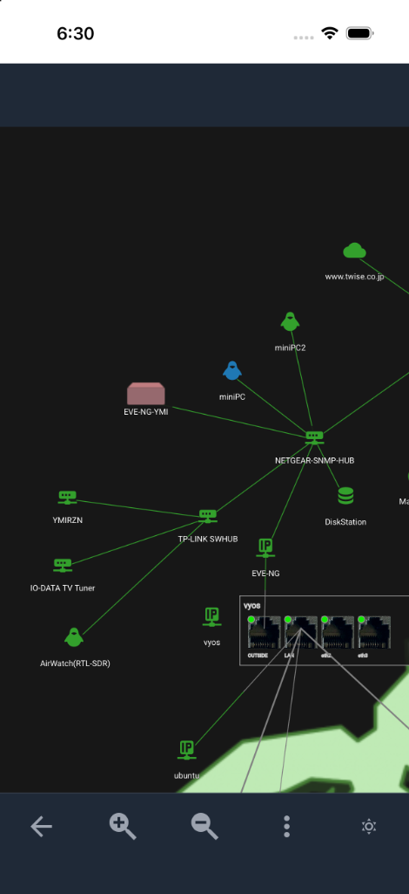
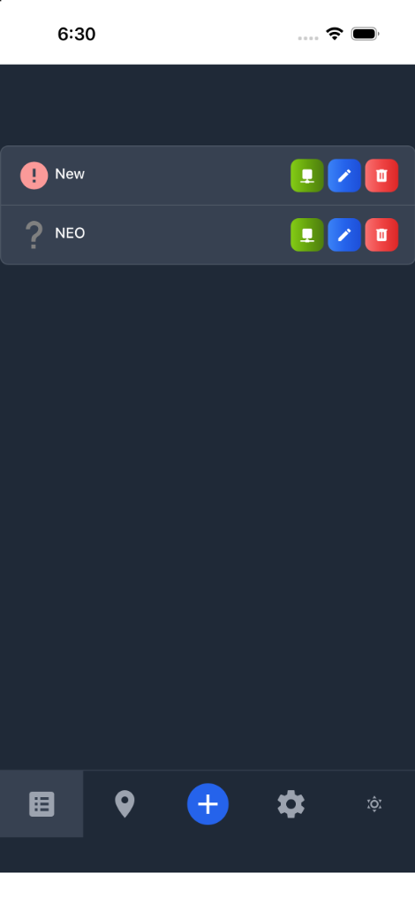
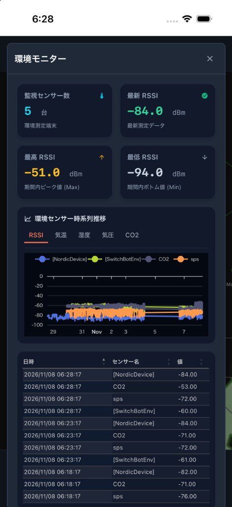
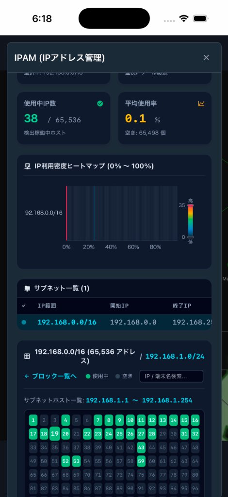
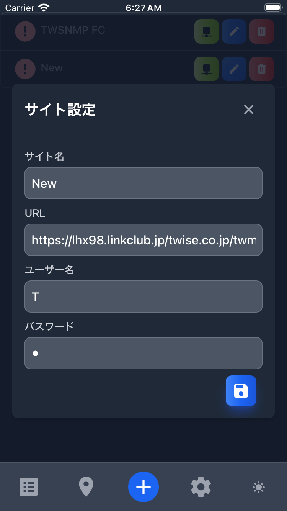
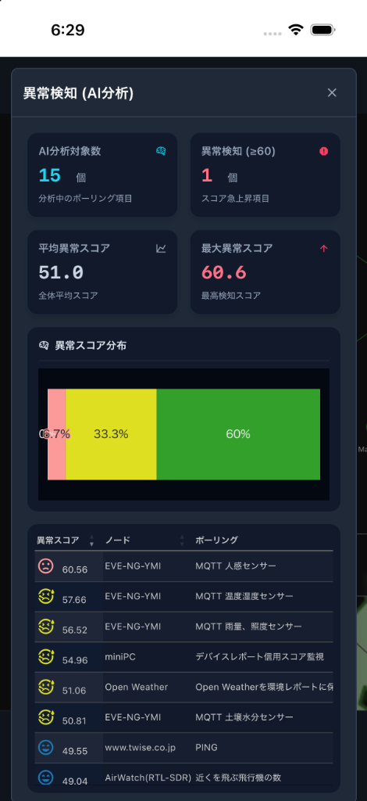

# TWSNMP Map Viewer (twsnmpmv)

[English](./README_en.md)

TWSNMP Map Viewerは、[TWSNMP FC](https://github.com/twsnmp/twsnmpfc)や[TWSNMP NEO](https://github.com/twsnmp/twsnmpneo)で管理されているネットワークの状態をモバイルで視覚化するためのアプリケーションです。複数のTWSNMPサイトを監視し、ネットワークマップを表示して、ノードやポーリングの状態をリアルタイムで追跡できます。

## 特徴

- **マルチサイト対応:** 複数のTWSNMPインスタンス（FC / NEO）を同時に監視。
- **インタラクティブなネットワークマップ:** ノード、ライン、ステータスインジケータを使用してネットワークレイアウトを視覚化。MapLibre GLによる背景地図表示にも対応。
- **リアルタイムステータス更新:** 設定されたサイトから定期的にステータスを取得。
- **ステータスの視覚化:** 色分けされたステータス（正常、注意、軽度、重度）とアイコンで素早く識別可能。
- **充実したレポートとKPIダッシュボード:** IPAM、環境、LAN、証明書、イベントログ、ノード、ポーリング、異常検知などの各レポート画面を刷新。KPIサマリーカード、グラフ表示、IPAMヒートマップ/ホストグリッド表示に対応。
- **モバイル最適化:** Capacitorによるネイティブアプリ化、安全領域（セーフエリア）や入力モードの最適化による快適な操作性を提供。

## ダウンロード

- **iOS:** [App Store](https://apps.apple.com/app/twsnmp-map-viewer/id1638466710)からダウンロードできます。
- **Android:** [GitHubのリリース](https://github.com/twise-oss/twsnmpmv/releases)からAPKファイルをダウンロードできます。

## スクリーンショット

| マップ | サイトリスト |
| :---: | :---: |
|  |  |

| 環境レポート | IPAMレポート |
| :---: | :---: |
|  |  |

| サイト編集 | 異常検知 |
| :---: | :---: |
|  |  |

## 技術スタック

- **Frontend:** [Svelte 5](https://svelte.dev/) + [TypeScript](https://www.typescriptlang.org/)
- **Build Tool:** [Vite 8](https://vitejs.dev/)
- **Visualization:** [p5.js](https://p5js.org/) (ネットワークマップの描画), [MapLibre GL](https://maplibre.org/)
- **Mobile Platform:** [Capacitor](https://capacitorjs.com/)
- **Styling:** [Tailwind CSS](https://tailwindcss.com/)
- **Testing / E2E:** [Vitest](https://vitest.dev/), [Playwright](https://playwright.dev/)
- **API Communication:** Fetch API + JWT認証

## アーキテクチャ概要

本アプリケーションは、シンプルなストアベースのアーキテクチャを採用しています。

- **DataStore (`src/lib/datastore.ts`):** アプリケーションの状態（TWSNMPサイトのリストや現在のステータスなど）を管理する中心的なハブ。Capacitor Preferencesを使用してデータを永続化します。
- **TwsnmpAPI (`src/lib/twsnmpapi.ts`):** TWSNMP REST APIとやり取りするためのラッパー。
- **Map Library (`src/lib/map.ts`):** p5.jsを使用してネットワークマップをレンダリングし、ズームなどのユーザーインタラクションを処理する専用ライブラリ。
- **Svelte Components:** UIレイヤー。`src/lib/`内の再利用可能なコンポーネントとして構成されています。

## 自分でビルドする場合

### 前提条件

- [mise](https://mise.jdx.dev/) (ツールとタスクの管理に推奨)
- Node.js (miseで管理)
- Java OpenJDK 21 (miseで管理)

### インストール

1. リポジトリをクローンする:
   ```bash
   git clone https://github.com/twise-oss/twsnmpmv.git
   cd twsnmpmv
   ```

2. ツールと依存関係をインストールする:
   ```bash
   mise install
   npm install
   ```

### 開発

開発サーバーを起動する:

```bash
mise run dev
```

単体テストを実行する:

```bash
mise run test
```

### E2Eテストと操作録画

このプロジェクトでは、E2Eテストおよび画面操作の自動録画に[Playwright](https://playwright.dev/)を使用しています。モバイルブラウザ（Mobile Chrome / Mobile Safari）環境をエミュレートして実行します。

#### テストの実行

すべてのE2Eテストを実行する場合:
```bash
mise run e2e:test
```

対話型UIモードでE2Eテストを実行・デバッグする場合:
```bash
mise run e2e:ui
```

#### 操作の録画

テストシナリオを実行し、操作画面をMP4動画として録画する場合（`recordings/` ディレクトリに保存されます）:
```bash
mise run e2e:record
```

### ビルドと実行

このプロジェクトでは、`mise`を使用してWebおよびモバイルプラットフォーム向けのビルドと同期タスクを調整しています。

#### Webプロダクションビルド
```bash
mise run build
```

#### Android
- **エミュレータでのデバッグ:**
  ```bash
  mise run debug:android
  ```
- **リリース用APKのビルド:**
  ```bash
  mise run release:android
  ```

#### iOS
- **シミュレータでのデバッグ:**
  ```bash
  mise run debug:ios
  ```
- **リリース用ビルド:**
  ```bash
  mise run release:ios
  ```

#### フルリリース (両プラットフォーム)
```bash
mise run release
```

## ライセンス

このプロジェクトはApache License 2.0の下でライセンスされています。詳細は[LICENSE](LICENSE)ファイルを参照してください。
