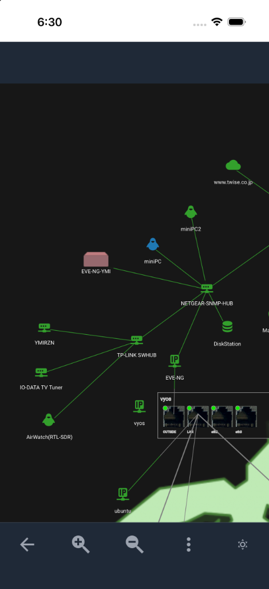
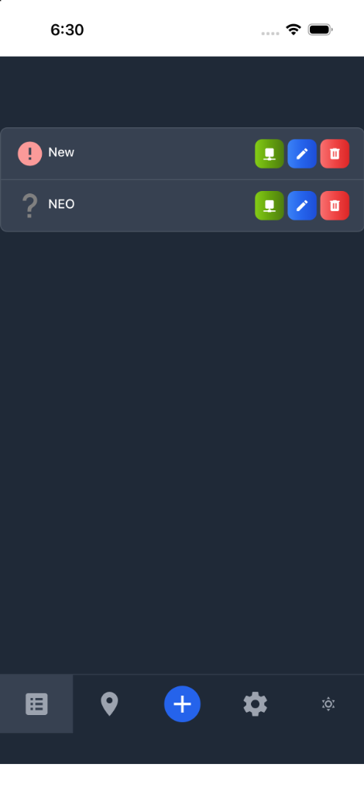
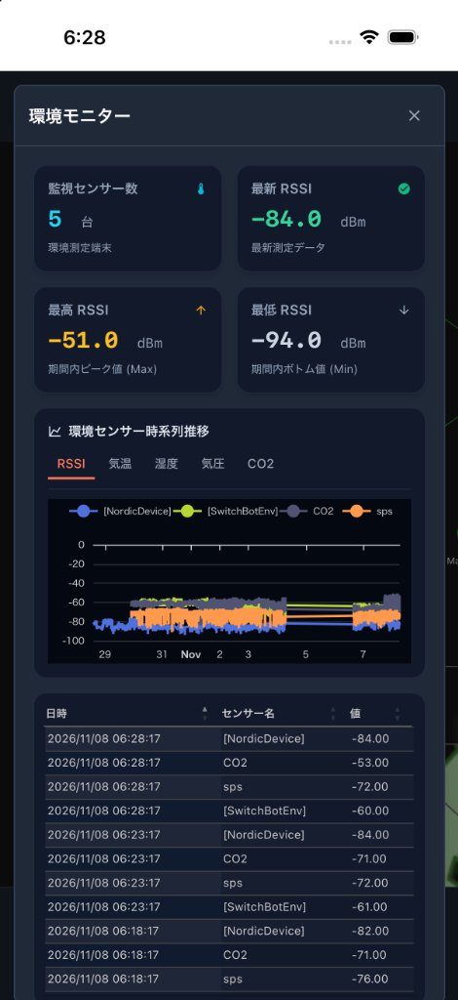
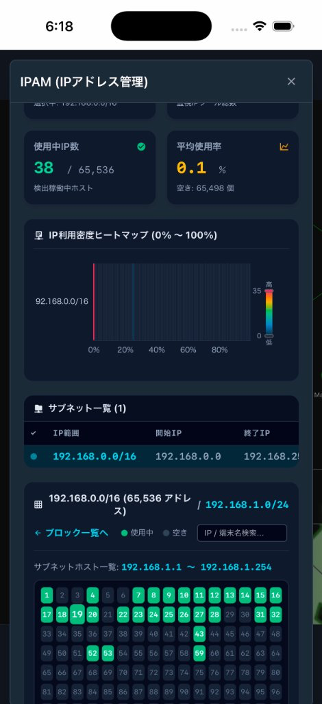
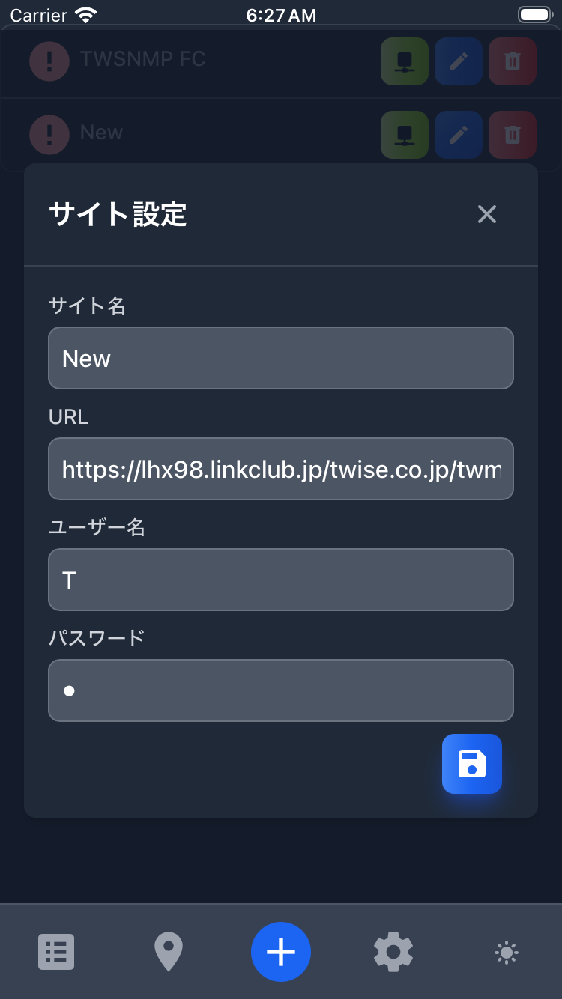
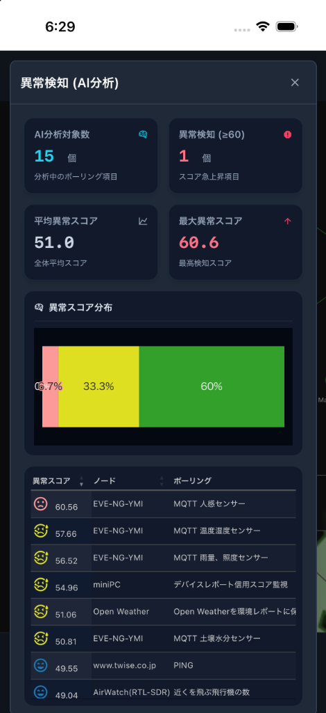

# TWSNMP Map Viewer (twsnmpmv)

[日本語](./README.md)

TWSNMP Map Viewer is a mobile application designed to visualize network status managed by [TWSNMP FC](https://github.com/twsnmp/twsnmpfc) and [TWSNMP NEO](https://github.com/twsnmp/twsnmpneo). It allows users to monitor multiple TWSNMP sites, view network maps, and track the status of nodes and pollings in real-time.

## Features

- **Multi-site Support:** Monitor multiple TWSNMP instances (FC / NEO) simultaneously.
- **Interactive Network Map:** Visualize your network layout with nodes, lines, and status indicators. Supports MapLibre GL background maps.
- **Real-time Status Updates:** Periodically fetches status from configured sites.
- **Status Visualization:** Color-coded status (Normal, Warning, Low, High) and icons for quick identification.
- **Comprehensive Reports & KPI Dashboards:** Redesigned report views for IPAM, Environmental monitoring, LAN, Certificates, Event Logs, Nodes, Pollings, and Anomaly Detection. Equipped with KPI summary cards, status charts, an IP density heatmap, and an interactive host grid.
- **Mobile Optimized:** Built with Capacitor for a seamless mobile experience with safe area layout and optimized touch and keyboard input handling.

## Download

- **iOS:** Download from the [App Store](https://apps.apple.com/app/twsnmp-map-viewer/id1638466710).
- **Android:** Download the APK from [GitHub Releases](https://github.com/twise-oss/twsnmpmv/releases).

## Screenshots

| Map | Site List |
| :---: | :---: |
|  |  |

| Environment Report | IPAM Report |
| :---: | :---: |
|  |  |

| Site Edit | Anomaly Detection |
| :---: | :---: |
|  |  |

## Technology Stack

- **Frontend:** [Svelte 5](https://svelte.dev/) + [TypeScript](https://www.typescriptlang.org/)
- **Build Tool:** [Vite 8](https://vitejs.dev/)
- **Visualization:** [p5.js](https://p5js.org/) (Network map rendering), [MapLibre GL](https://maplibre.org/)
- **Mobile Platform:** [Capacitor](https://capacitorjs.com/)
- **Styling:** [Tailwind CSS](https://tailwindcss.com/)
- **Testing / E2E:** [Vitest](https://vitest.dev/), [Playwright](https://playwright.dev/)
- **API Communication:** Fetch API + JWT Authentication

## Architecture Overview

The application follows a simple store-based architecture:

- **DataStore (`src/lib/datastore.ts`):** The central hub for managing application state, including the list of TWSNMP sites and their current status. It persists data using Capacitor Preferences.
- **TwsnmpAPI (`src/lib/twsnmpapi.ts`):** A wrapper for interacting with the TWSNMP REST API.
- **Map Library (`src/lib/map.ts`):** A specialized library using p5.js to render the network map and handle user interactions like zooming.
- **Svelte Components:** The UI layer, organized into reusable components in `src/lib/`.

## Building by Yourself

### Prerequisites

- [mise](https://mise.jdx.dev/) (recommended for managing tools and tasks)
- Node.js (managed by mise)
- Java OpenJDK 21 (managed by mise)

### Installation

1. Clone the repository:
   ```bash
   git clone https://github.com/twise-oss/twsnmpmv.git
   cd twsnmpmv
   ```

2. Install tools and dependencies:
   ```bash
   mise install
   npm install
   ```

### Development

Start the development server:

```bash
mise run dev
```

Run unit tests:

```bash
mise run test
```

### E2E Testing & Screen Recording

This project uses [Playwright](https://playwright.dev/) for automated E2E testing and screen recording, emulating mobile browsers (Mobile Chrome and Mobile Safari).

#### Running Tests

To run all E2E tests:
```bash
mise run e2e:test
```

To run tests in interactive UI mode:
```bash
mise run e2e:ui
```

#### Recording Operations

To run the test scenario and record screen interactions as an MP4 video (saved to `recordings/`):
```bash
mise run e2e:record
```

### Building and Running

This project uses `mise` to orchestrate build and synchronization tasks for web and mobile platforms.

#### Web Production Build
```bash
mise run build
```

#### Android
- **Debug on Emulator:**
  ```bash
  mise run debug:android
  ```
- **Build Release APK:**
  ```bash
  mise run release:android
  ```

#### iOS
- **Debug on Simulator:**
  ```bash
  mise run debug:ios
  ```
- **Build Release:**
  ```bash
  mise run release:ios
  ```

#### Full Release (Both Platforms)
```bash
mise run release
```

## License

This project is licensed under the Apache License 2.0 - see the [LICENSE](LICENSE) file for details.
